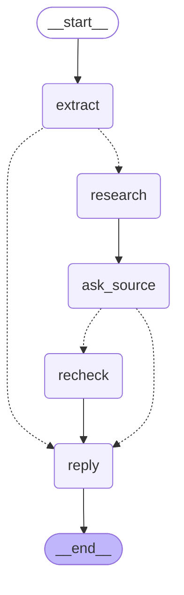
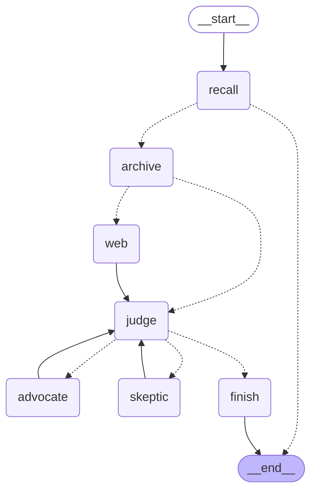

# fact-checker

Paste a forwarded message (text or screenshot). The agent pulls out its checkable claims, researches each one in
parallel, has two researchers argue opposite sides when the evidence is unclear, and replies in the sender's
language with a verdict per claim (true / false / misleading / unverifiable) and its sources.

## How it works

Main graph (`src/fact_checker/graph.py`, diagrams generated with `graph.get_graph().draw_mermaid()`):

1. **extract**: Claude reads the message (and screenshot), returns up to 5 stand-alone claims in English plus the
   message's language.
2. **research**: one `Send` per claim, so claims are researched in parallel by the subgraph below.
3. **ask_source**: a join. Once every claim is done, if any is unverifiable it `interrupt()`s to ask the user for a
   link. The run is checkpointed in Postgres, so the answer can come hours later.
4. **recheck**: the same subgraph, run again for the unverified claims with the user's link as extra evidence.
5. **reply**: Claude writes a short, kind reply in the sender's language.

Research subgraph, one claim:

- **recall** (memory): semantic search over earlier verdicts. Jev confirms it is the *same* claim before reusing one.
- **archive** (RAG): ~90k professional fact-checks from Google's ClaimReview feed, in pgvector. Viral hoaxes repeat,
  so an existing fact-check is the most precise evidence.
- **web** (corrective RAG): Tavily search, only when the archive has nothing usable or the user gave a link.
- **judge**: Claude, at high effort, decides from the evidence only and cites evidence ids.
- **advocate / skeptic** (multi-agent): when the judge is unsure or says unverifiable, two tool-using agents search
  for the strongest case on each side, in parallel. Then the judge decides again, once.
- **finish**: a verdict that cites no existing evidence becomes "unverifiable". Confident verdicts are remembered.

## Design decisions

**Jev (TypeSafe's System One model) only where it loses no quality.** Jev returns calibrated probabilities for
narrow questions, fast and cheaply, and its [documented weak spots](https://docs.typesafe.ai/model-jaggedness/jev-1.13.md)
are generation, multi-hop reasoning, dates and long state. So it handles the high-volume gates, and everything
generative or multi-step stays with Claude:

| Decision | Model | Why |
|---|---|---|
| Does this passage help decide the claim? (per passage) | Jev Noul | single-hop relevance on short state; the most frequent call |
| Does this passage try to instruct the system? | Jev Noul | same request, a second question costs nothing extra |
| Is this new claim the same as a remembered one? | Jev Noul | paraphrase match on two sentences |
| Claim extraction, verdict, debate, reply | Claude | generation and multi-hop reasoning over several sources and dates |

`tests/test_jev.py` checks the gates live, including a Hindi paraphrase and a changed number.

**Evidence is capped at the claim's date (`as_of`).** Live checks use the day the message arrived. Evals use each
claim's original date, so the agent can't find the very fact-check the benchmark claim came from. Same code path,
no special eval mode.

**A verdict must cite evidence that exists.** A deterministic check in `finish` instead of another LLM grader: it is
free, and it can't itself hallucinate.

**Memory reuses only confident, recent verdicts.** Below 0.8 confidence nothing is stored, and verdicts older than
30 days are re-checked: a wrong verdict served to every later forward of the same claim is worse than re-checking.

**One Postgres** holds the fact-check archive (pgvector), graph checkpoints and long-term memory (LangGraph store).

**Claude Opus 5.5 with effort per step**: low for extraction and reply, medium for debaters, high for the judge.
Requests opt into server-side fallbacks so a safety-classifier refusal on health or politics claims retries on
another model instead of failing.

## Run it

Needs Docker, [uv](https://docs.astral.sh/uv/), and API keys for Anthropic, OpenAI (embeddings), Tavily and TypeSafe.

1. `cp .env.example .env` and fill in the keys
2. `docker compose up -d` (Postgres with pgvector on port 5433)
3. `uv run python -m fact_checker.ingest` (downloads and embeds the fact-check archive; estimate: 10 to 20 minutes,
   about $0.05 of embeddings; re-run any time to add new fact-checks)
4. `uv run streamlit run src/fact_checker/app.py`

Tests: `uv run pytest` (Jev tests run when `TYPESAFE_API_KEY` is set). Tracing: set the LangSmith variables in `.env`.

## Evals

`uv run python evals/averitec.py 40` runs the research subgraph on 40 claims from the
[AVeriTeC](https://github.com/MichSchli/AVeriTeC) dev set (real-world claims with gold verdicts) and writes accuracy,
macro-F1, a confusion table and token usage to `evals/results/`. Commit the result file with the change it measures.

## Not built yet

- A chat channel (Telegram or WhatsApp). The UI is a Streamlit page; `Forward` is the input either would fill.
- Hybrid (keyword + vector) archive search, for names and numbers that embeddings blur.
