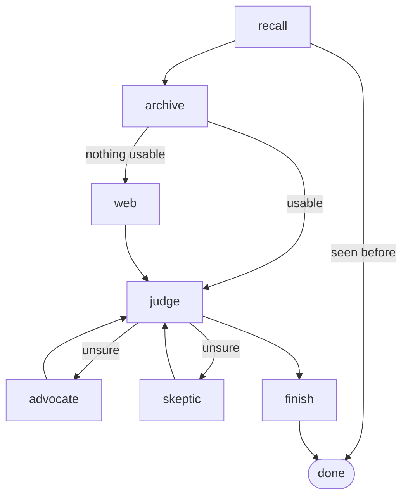

# fact-checker

Paste a forwarded message (text or screenshot). It extracts the checkable claims, researches each in parallel, and
replies in the sender's language with a verdict per claim (true / false / misleading / unverifiable) and sources.

## How it works

`src/fact_checker/graph.py` (LangGraph): `extract → research (one per claim, via Send) → reply`. Research, per claim:

- **recall** (memory): earlier verdicts; Jev confirms it is the same claim before one is reused.
- **archive** (RAG): ~88k professional fact-checks from Google's ClaimReview feed, in pgvector.
- **web** (corrective RAG): Tavily search.
- **advocate / skeptic** (multi-agent): two tool-using agents argue opposite sides, then the judge decides again, once.
- **finish**: a verdict citing no real evidence becomes unverifiable; confident ones (≥ 0.8) are remembered for 30 days.

## Design decisions

- **Jev only where it loses no quality**: passage relevance, prompt-injection and same-claim checks. Extraction,
  judging, debate and the reply stay with Claude: they generate text or reason across sources and dates, which are
  Jev's [documented weak spots](https://docs.typesafe.ai/model-jaggedness/jev-1.13.md).
- **Evidence is capped at the claim's date**, so evals can't find the fact-check a benchmark claim came from.
- **The citation guard is code, not an LLM grader**: free, and it can't hallucinate.
- **Source credibility comes from published ratings**, not a hand-picked list: [Lin et al. 2023](https://github.com/hauselin/domain-quality-ratings)
  rate ~11.5k news domains; official `.gov`/`.edu`-style sites count too. The judge weighs it; a primary source
  (a company's own blog) can still settle a claim.
- **One Postgres** holds the archive, graph checkpoints and memory.
- **Public, no login**: 10 checks per IP per day, and an admin Telegram bot that reports each check.

## Run

One Railway project, deployed from this repo:

- **app**: the Streamlit page (`Procfile`). API keys are set here; the jobs reference them.
- **ingest**: daily cron, `python -m fact_checker.ingest`. Adds new fact-checks to the archive.
- **evals**: monthly cron, `python evals/averitec.py 5` (40 once cost per claim is known). Run it now with `railway cron run --service evals`.
- **Postgres**: archive, checkpoints, memory and eval runs.

Locally: copy `.env.example` to `.env` and run the same commands with `uv run`. Tests: `uv run pytest`.

## Evals

`evals/averitec.py` runs research on n (default 40) [AVeriTeC](https://github.com/MichSchli/AVeriTeC) claims and saves accuracy,
macro-F1, a confusion table and token usage to the `eval_runs` table, with the deployed commit.
